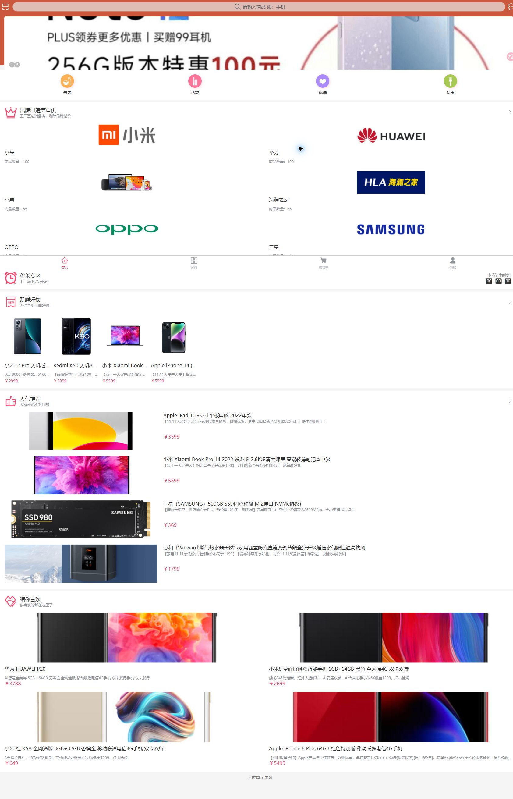
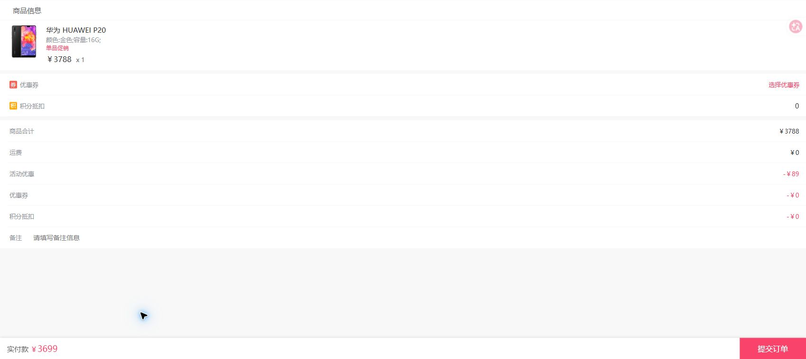

# Mall 电商全栈项目

本仓库将 Mall 的 Java 后端、管理端 Web 应用和移动端 H5 店铺整理为一套可在本地运行的演示环境。上游业务代码按原仓库快照保留；本仓库补充本地依赖服务配置、启动步骤和运行验证记录。

本仓库不把上游功能描述为本仓库新开发的功能。各子项目来源、版本和许可证见 [UPSTREAMS.md](UPSTREAMS.md)。

## 项目组成

| 路径 | 说明 | 技术 |
|---|---|---|
| mall/ | 管理端与商城门户 API | Java 17、Spring Boot、MyBatis |
| mall-admin-web/ | 商城管理后台 | Vue 3、Vite、Element Plus |
| mall-app-web/ | 移动端 H5 商城 | Vue 3、uni-app、Vite |
| docker-compose.yml | MySQL、Redis、MongoDB、RabbitMQ 本地服务 | Docker Compose |

## 环境要求

- Docker Desktop 和 Docker Compose
- JDK 17
- Maven 3.9 或更新版本
- Node.js 20.19 或更新版本

## 启动本地依赖服务

在仓库根目录使用 PowerShell：

    Copy-Item .env.example .env

编辑 .env，将 MYSQL_ROOT_PASSWORD 改成仅供本机使用的密码，然后启动服务：

    docker compose up -d

首次启动时会将 mall/document/sql/mall.sql 导入 mall 数据库。MySQL、Redis、MongoDB 和 RabbitMQ 数据保存在 Docker 命名卷中；已有数据卷不会重复初始化。

| 服务 | 本机地址 |
|---|---|
| MySQL | localhost:13306 |
| Redis | localhost:16379 |
| MongoDB | localhost:27018 |
| RabbitMQ | localhost:5673 |
| RabbitMQ 管理界面 | http://localhost:15673/ |

本地 RabbitMQ 使用用户名 mall、密码 mall、虚拟主机 /mall。这些是演示环境设置，不应直接用于生产。

## 构建和启动后端

在仓库根目录打开 PowerShell，构建管理端和商城门户：

    Set-Location mall
    mvn -pl mall-admin -am -DskipTests -Ddocker.skip=true package
    mvn -pl mall-portal -am -DskipTests -Ddocker.skip=true package

在管理端终端中设置与 .env 相同的 MySQL 密码，然后启动 API：

    $env:MYSQL_ROOT_PASSWORD = '替换为 .env 中的密码'
    java -jar .\mall-admin\target\mall-admin-1.0-SNAPSHOT.jar --server.port=18080 '--spring.datasource.url=jdbc:mysql://localhost:13306/mall?useUnicode=true&characterEncoding=utf-8&serverTimezone=Asia/Shanghai&useSSL=false' ( '--spring.datasource.password=' + $env:MYSQL_ROOT_PASSWORD ) --spring.data.redis.port=16379

在另一个终端中，从 mall 目录启动商城门户 API：

    $env:MYSQL_ROOT_PASSWORD = '替换为 .env 中的密码'
    java -jar .\mall-portal\target\mall-portal-1.0-SNAPSHOT.jar --server.port=18085 '--spring.datasource.url=jdbc:mysql://localhost:13306/mall?useUnicode=true&characterEncoding=utf-8&serverTimezone=Asia/Shanghai&useSSL=false' ( '--spring.datasource.password=' + $env:MYSQL_ROOT_PASSWORD ) --spring.data.redis.port=16379 --spring.data.mongodb.port=27018 --spring.rabbitmq.port=5673

两个终端都需要保持运行。后端地址分别为 http://localhost:18080 和 http://localhost:18085。

## 启动管理端和 H5 店铺

在 mall-admin-web 目录创建未跟踪的 .env.development.local，内容如下：

    VITE_BASE_SERVER_URL=http://localhost:18080

然后安装依赖并启动管理端：

    npm ci
    npm run dev -- --host 127.0.0.1 --port 5174

在 mall-app-web 目录创建未跟踪的 .env.development.local，内容如下：

    VITE_API_BASE_URL=http://localhost:18085
    VITE_USE_ALIPAY=false

然后安装依赖并启动 H5 店铺：

    npm ci
    npm run dev:h5 -- --host 127.0.0.1 --port 5175

| 应用 | 地址 |
|---|---|
| 管理端 | http://127.0.0.1:5174/ |
| H5 店铺 | http://127.0.0.1:5175/ |
| 管理端 API 健康检查 | http://localhost:18080/actuator/health |
| 门户 API 健康检查 | http://localhost:18085/actuator/health |

## 页面记录

### H5 店铺首页

### 订单确认页

### 已创建订单

## 验证记录

构建结果、页面访问和下单流程记录见 [docs/VERIFICATION.md](docs/VERIFICATION.md)。Maven 构建明确跳过了自动化测试；本仓库不声称上游测试套件通过。

## 许可证与来源

各上游项目保留自己的许可证文件和通知。组合仓库的上游地址、快照提交和说明见 [UPSTREAMS.md](UPSTREAMS.md)。请遵循每个上游项目及其依赖的许可证要求。
