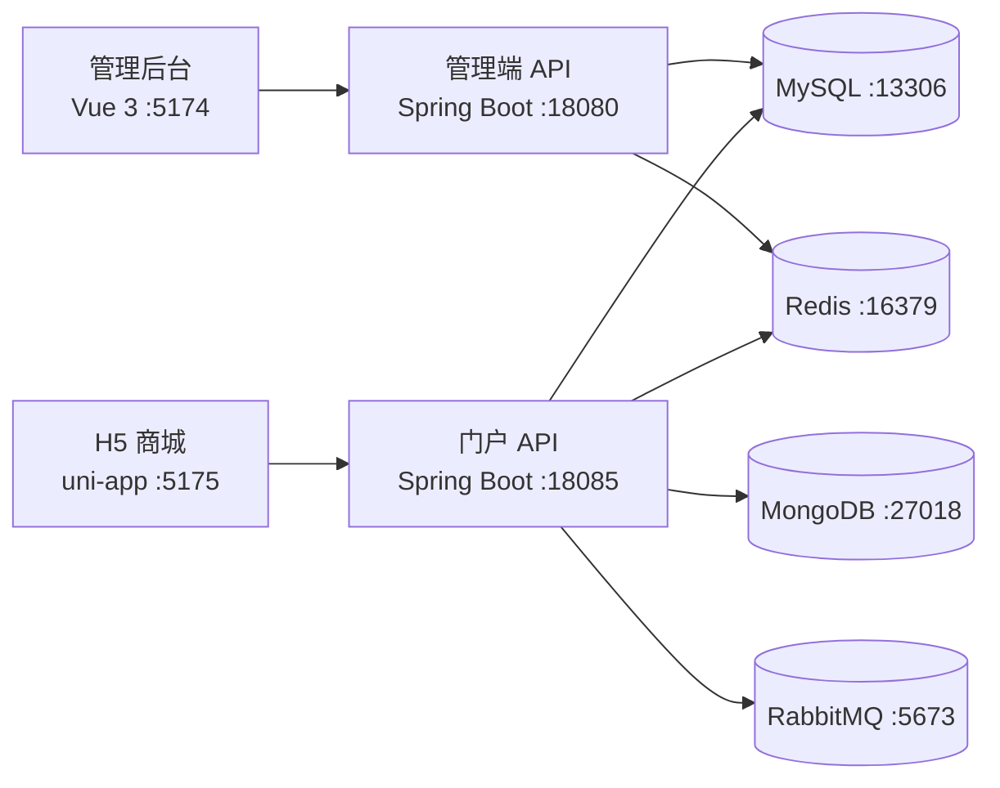
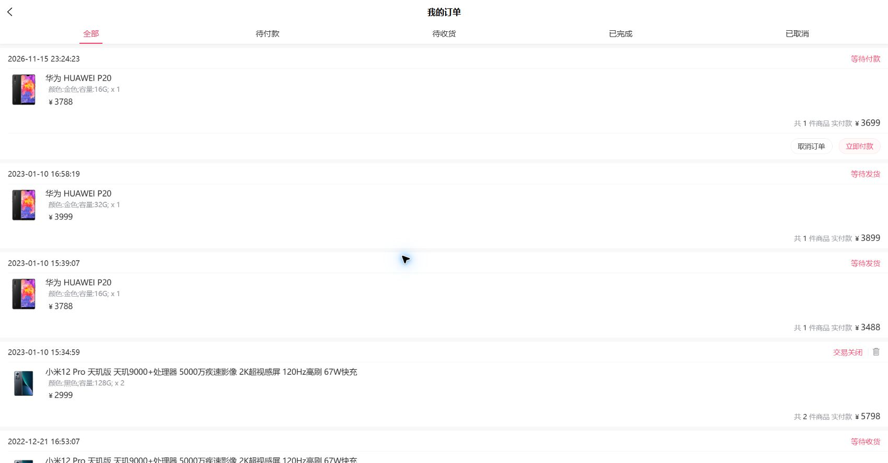

# Mall 电商全栈本地演示

将 Mall Java 服务端、Vue 管理后台、H5 商城与所需中间件组合成可在本机启动和验证的一套环境，方便了解电商项目的前后端协作与典型下单流程。

> **代码来源说明**：业务应用来自 Macrozheng 的三个开源仓库快照。本仓库负责组合项目、配置本地依赖服务、整理启动说明并记录验证过程；不将上游业务代码描述为本仓库原创。来源、快照版本和许可证见 [`UPSTREAMS.md`](UPSTREAMS.md)。

## 项目一览

| 模块 | 路径 | 主要技术 |
| --- | --- | --- |
| 商城管理端 API、门户 API | [`mall/`](mall/) | Java 17、Spring Boot、MyBatis、Maven |
| 商城管理后台 | [`mall-admin-web/`](mall-admin-web/) | Vue 3、Vite、Element Plus |
| 移动端 H5 商城 | [`mall-app-web/`](mall-app-web/) | Vue 3、uni-app、Vite |
| 本地中间件 | [`docker-compose.yml`](docker-compose.yml) | MySQL 8、Redis 7、MongoDB 7、RabbitMQ |

本地演示链路覆盖：启动依赖服务 → 启动两个 Java API → 访问管理后台和 H5 店铺 → 登录、选购商品并创建待付款订单。

## 架构与本地地址



| 应用 / 服务 | 本机地址 |
| --- | --- |
| 管理后台 | <http://127.0.0.1:5174/> |
| H5 商城 | <http://127.0.0.1:5175/> |
| 管理端健康检查 | <http://localhost:18080/actuator/health> |
| 门户健康检查 | <http://localhost:18085/actuator/health> |
| RabbitMQ 管理界面 | <http://localhost:15673/> |

MySQL、Redis、MongoDB 和 RabbitMQ 分别映射到本机端口 `13306`、`16379`、`27018` 和 `5673`。RabbitMQ 演示账号为 `mall`，密码为 `mall`，虚拟主机为 `/mall`；这些凭据只用于本地演示。

## 环境要求

- Docker Desktop（包含 Docker Compose）
- JDK 17
- Maven 3.9 或更新版本
- Node.js 20.19 或更新版本及 npm
- Windows PowerShell（以下命令以 PowerShell 为例；其他系统请按对应 shell 调整环境变量语法）

## 快速启动

以下命令从仓库根目录执行。首次启动会下载镜像、Maven 依赖和 npm 包，并通过 [`mall/document/sql/mall.sql`](mall/document/sql/mall.sql) 初始化本地数据库。

### 1. 配置并启动中间件

```powershell
Copy-Item .env.example .env
```

编辑 `.env`，将 `MYSQL_ROOT_PASSWORD` 替换成本机使用的密码，然后运行：

```powershell
docker compose up -d
docker compose ps
```

MySQL 初始化脚本只会在数据卷首次创建时执行。要重置本地演示数据，可先停止服务，再删除对应数据卷；删除卷会清空其中的数据。

### 2. 构建并启动 Java 服务

在一个 PowerShell 窗口中构建两个后端模块：

```powershell
Set-Location .\mall
mvn -pl mall-admin -am -DskipTests -Ddocker.skip=true package
mvn -pl mall-portal -am -DskipTests -Ddocker.skip=true package
```

启动管理端 API（该窗口保持运行）：

```powershell
$env:MYSQL_ROOT_PASSWORD = '替换为 .env 中设置的密码'
java -jar .\mall-admin\target\mall-admin-1.0-SNAPSHOT.jar `
  --server.port=18080 `
  '--spring.datasource.url=jdbc:mysql://localhost:13306/mall?useUnicode=true&characterEncoding=utf-8&serverTimezone=Asia/Shanghai&useSSL=false' `
  ('--spring.datasource.password=' + $env:MYSQL_ROOT_PASSWORD) `
  --spring.data.redis.port=16379
```

再打开一个 PowerShell 窗口，同样进入仓库的 `mall` 目录并设置数据库密码，启动门户 API：

```powershell
Set-Location .\mall
$env:MYSQL_ROOT_PASSWORD = '替换为 .env 中设置的密码'
java -jar .\mall-portal\target\mall-portal-1.0-SNAPSHOT.jar `
  --server.port=18085 `
  '--spring.datasource.url=jdbc:mysql://localhost:13306/mall?useUnicode=true&characterEncoding=utf-8&serverTimezone=Asia/Shanghai&useSSL=false' `
  ('--spring.datasource.password=' + $env:MYSQL_ROOT_PASSWORD) `
  --spring.data.redis.port=16379 `
  --spring.data.mongodb.port=27018 `
  --spring.rabbitmq.port=5673
```

### 3. 启动管理后台

在仓库根目录创建 `mall-admin-web/.env.development.local`，内容如下：

```dotenv
VITE_BASE_SERVER_URL=http://localhost:18080
```

然后运行：

```powershell
Set-Location .\mall-admin-web
npm ci
npm run dev -- --host 127.0.0.1 --port 5174
```

### 4. 启动 H5 商城

在仓库根目录创建 `mall-app-web/.env.development.local`，内容如下：

```dotenv
VITE_API_BASE_URL=http://localhost:18085
VITE_USE_ALIPAY=false
```

然后运行：

```powershell
Set-Location .\mall-app-web
npm ci
npm run dev:h5 -- --host 127.0.0.1 --port 5175
```

前端开发服务器与两个 Java API 都需要保持运行。各 `.env` 本地配置文件不应提交到 Git。

## 页面预览

### H5 商城首页


### 订单确认


### 创建订单后



## 验证结果与范围

本地验证记录详见 [`docs/VERIFICATION.md`](docs/VERIFICATION.md)。验证包括两个 Java 模块打包、两个前端构建、管理后台与 H5 首页 HTTP 200、两个 API 健康检查，以及一笔从选品到创建订单的 H5 流程。样例订单金额为商品 `¥3,788`、优惠 `¥89`、应付 `¥3,699`，订单状态为待付款。

Maven 打包时使用了 `-DskipTests`，因此**没有运行上游自动化测试套件**。该流程没有调用支付接口或真实支付渠道，也不代表性能、并发或生产环境验证。

## 来源与许可证

本仓库包含以下上游项目的代码快照，并保留各自许可证和相关通知：

- [macrozheng/mall](https://github.com/macrozheng/mall)
- [macrozheng/mall-admin-web](https://github.com/macrozheng/mall-admin-web)
- [macrozheng/mall-app-web](https://github.com/macrozheng/mall-app-web)

各目录的具体提交版本、许可证和本地组合说明见 [`UPSTREAMS.md`](UPSTREAMS.md)。使用或再分发时请遵循对应上游项目及其依赖的许可证要求。
